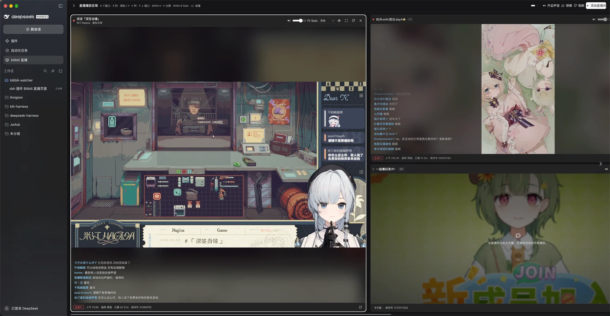

# dsh-bilibili-multiview

[](LICENSE)

DSH 插件：在 DeepSeek Harness 的侧边栏「自动任务」下面增加一个 **bilibili 直播** 页面，以 Niri 风格管理多个直播窗口。

> 仓库名、包 ID、Client 模块 id 与 Host 路由均为 `dsh-bilibili-multiview`；侧边栏显示名保持「bilibili 直播」。



*4 个窗口 · 3 列；列内上下分屏，直播列表已收起。*

- 直播间列表可折叠：用快捷键切换/移动窗口时自动收起；也可点击播放区左上角按钮展开/收起
- 添加 / 移除直播间、账号 Cookie 设置、封面通过 Host 同源图片代理加载
- 播放区域按 **Niri 水平滚动窗口** 管理：滚轮、← →、Home/End、窗口圆点、底部滚动条
- **列内上下分屏**：把窗口移入相邻列即自动上下堆叠；支持列内上下移动、拆分独立列、整列移动
- 每个窗口独立音量、**Solo 独奏**（`Shift+S`；Solo 跟随焦点，激活时焦点边框变红）、`+` / `-` 调整焦点窗口音量（每次 5%）、画质切换、全屏
- 切换焦点窗口时，其余窗口音量自动降为 **20%**（即降低 80%，Solo 窗口保持原音量）
- 实时弹幕（DANMU_MSG / 礼物 / SC / 舰长），可全局开关
- 直播状态每 30 秒刷新，未开播时显示封面并等待开播

## 安装

```bash
git clone git@github.com:Xinrea/dsh-bilibili-multiview.git
```

然后让 DSH Agent 安装本目录（或使用插件管理器）：

```
plugin_manager install_bundle /absolute/path/to/dsh-bilibili-multiview
```

安装后刷新 Web 页面即可在侧边栏看到入口。

## Niri 窗口操作

水平方向是列，列内可以垂直堆叠多个窗口。每个窗口标题栏右侧的移动按钮（四向箭头）打开操作菜单，也可以直接用键盘：

| 操作 | 快捷键 |
| --- | --- |
| 切换列 | `←` / `→`、滚轮、底部滚动条 |
| 切换焦点窗口的 Solo | `Shift+S`（焦点窗口独奏，再按一次取消；Solo 会跟随之后的焦点切换） |
| 调整焦点窗口音量 | `+` / `-`（每次 5%，范围 0–100） |
| 列内切换窗口 | `↑` / `↓` |
| 窗口移入左/右列（自动上下分屏） | `Shift` + `←` / `→` |
| 列内上移/下移窗口 | `Shift` + `↑` / `↓` |
| 拆为左侧/右侧独立列 | `[` / `]` |
| 整列左移/右移 | `Alt` + `Shift` + `←` / `→` |

移动窗口后焦点跟随被移动的窗口；当前列窗口数会显示为标题旁的 `1/2` 标记。Solo 开启后焦点边框变红；切换到另一个窗口时 Solo 自动跟随，关闭当前 Solo 窗口时 Solo 也会转移到新的焦点窗口。任何焦点/移动快捷键都会自动收起直播列表；焦点之外的窗口音量按 20% 播放（降低 80%），标题栏音量滑杆也会以变暗提示。

## Cookie 与隐私

账号 Cookie **只保存在 Host 本机**：

```
$DSH_HOME/bili/cookies.json
```

页面、客户端插件、其它插件都拿不到 Cookie 内容；浏览器只调用同源的
`/bilibili-multiview/api/*` 代理。已有的同名文件会被直接复用。

登录 Cookie 用于账号信息、更高画质和弹幕身份；未设置 Cookie 时仍可匿名观看和
接收弹幕。

## 路由

Host 半在 DSH Web 服务上注册一个前缀路由：

| 路由 | 作用 |
| --- | --- |
| `GET /bilibili-multiview/vendor/mpegts.js` | 本地 mpegts.js 运行时 |
| `GET /bilibili-multiview/api/session` | 账号概要 |
| `POST /bilibili-multiview/api/session` | 校验并保存 Cookie |
| `DELETE /bilibili-multiview/api/session` | 清除 Cookie |
| `POST /bilibili-multiview/api/room` | 添加 / 查询单个直播间 |
| `POST /bilibili-multiview/api/rooms` | 批量刷新 |
| `POST /bilibili-multiview/api/play` | 获取 FLV 播放地址 |
| `POST /bilibili-multiview/api/danmu` | 获取弹幕 WS 主机与 token（诊断用） |
| `GET /bilibili-multiview/api/danmu/events?room=…` | SSE 弹幕流（页面实际使用） |
| `GET /bilibili-multiview/api/image?u=…` | 封面/关键帧/头像同源代理 |
| `GET /bilibili-multiview/api/stream?u=…` | CDN 拒绝页面 Origin 时的同源回退 |

## 实现说明

- 账号、直播流、弹幕接口参考了 `bili-shadowreplay` 的 Rust 实现，并移植为 Node：
  WBI 签名、`getRoomPlayInfo` 的 FLV 选择、`getDanmuInfo`、zlib/brotli 弹幕包解析。
- Bilibili comet WebSocket 会校验 `Origin`，从 `127.0.0.1` 直连会被 1006 关闭。因此由
  Host 持有上游 WebSocket（Origin 为 `https://live.bilibili.com`），解析后通过同源
  SSE 推送给页面；页面不接触 Cookie、token 或压缩包。
- FLV 优先走同源代理，失败时回退 CDN 直连；封面/关键帧/头像也走 Host 图片代理，
  避免 B 站图片 CDN 对浏览器热链的拒绝。
- 播放器使用 [mpegts.js](https://github.com/xqq/mpegts.js) 1.8.0（Apache-2.0），
  vendored 在 `vendor/`，许可证见 `vendor/mpegts.LICENSE`。
- 弹幕上游连接使用 [ws](https://github.com/websockets/ws) 8.17.1（MIT），vendored 在
  `vendor/ws/`，许可证见 `vendor/ws/LICENSE`。
- 原生只使用 React 与浏览器 API，不依赖 DSH Client 内部 UI 组件；样式全部使用
  `--dsw-alias-*` 主题 token，跟随明暗主题。

## 开发校验

```bash
node --check index.js
node --check client.js
node scripts/host-smoke.mjs      # 真实调用 Bilibili 接口与流代理
node scripts/client-smoke.mjs    # 校验 Client 模块与 Slot 注册
```

`scripts/` 不包含在发布文件列表中，仅供本地调试。

## License

本项目代码采用 MIT，见 [LICENSE](LICENSE)。

vendored 第三方运行时：

- `vendor/mpegts.min.js`：Apache-2.0，见 `vendor/mpegts.LICENSE`
- `vendor/ws/`：MIT，见 `vendor/ws/LICENSE`
